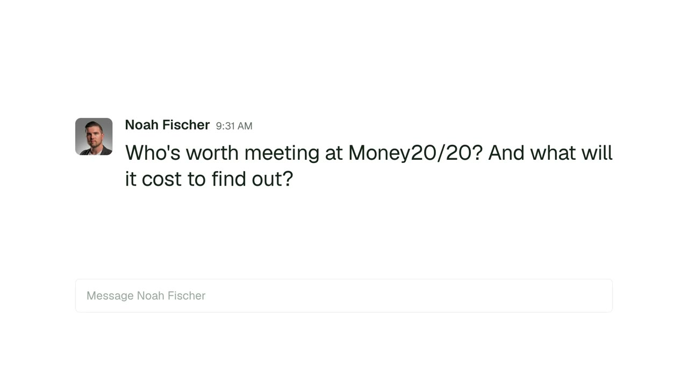
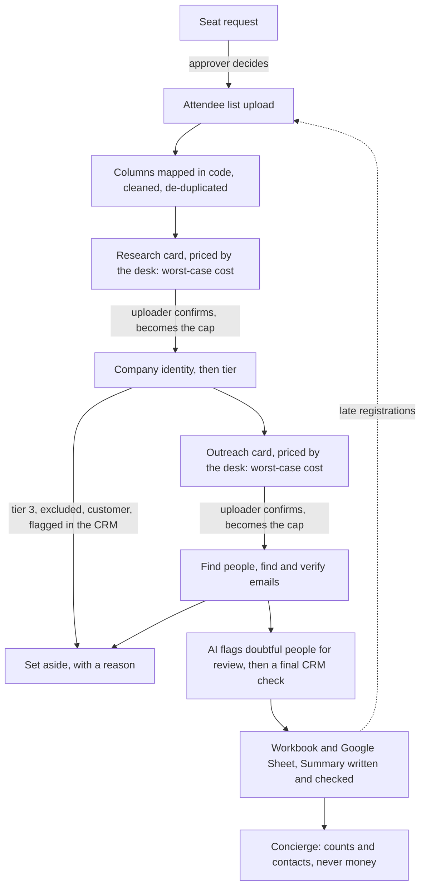

# Events Desk

[](https://github.com/bryanacevedo/events-desk/actions/workflows/ci.yml)

Events Desk is for a person who runs events all year. You go to a lot of conferences. For each one you need to know who asked for a seat and who said yes, who on the attendee list is worth meeting, and how to reach them without paying for the same data twice.

You ask for a seat. Someone approves it. You upload the attendee list. The desk works out which companies and people matter, finds and checks their emails, and hands back a Google Sheet (or an Excel file) your sales team can work from. If more people register later, you upload the new file and the desk adds only the new ones.

**[Try the live demo](https://events-desk.onrender.com)** · [Film (3:41)](https://bryanacevedo.github.io/project-videos/video/events-desk.mp4) · [Decisions](docs/DECISIONS.md). Everything in the demo is invented and every vendor is simulated. If it has been idle, the first load takes about a minute. The hosted demo is redeployed by hand, not on every push, so it can be behind the code in this repository.

It is a portfolio project. Read "What is proven and what is not" below before you trust any number in it.

[](https://bryanacevedo.github.io/project-videos/video/events-desk.mp4)

**[Watch the walkthrough (3:41)](https://bryanacevedo.github.io/project-videos/video/events-desk.mp4)**: the whole system, from the seat request to the result. It follows one company on the demo's attendee list and one person the desk found there, through a reply and a meeting to a deal. The people, vendors, CRM and AI calls in the demo are simulated.

## What it does for you

- **Seats.** Each person asks for their own seat from a catalog of events. Approvers decide. Nobody approves their own request. A budget warning never blocks a decision.
- **One attendee list per event.** Upload a CSV or Excel file. Columns are mapped in code, rows are cleaned and de-duplicated, and anything doubtful is set aside with a reason. The original file is kept until a person replaces the list or deletes the event.
- **A cost card before any spend.** There are two: a Research card (finding and tiering the companies) and an Outreach card (finding and checking the people). As soon as each can be made, the desk prices it itself and shows the worst case first: credits per data provider, and AI calls with an estimate in dollars. The person who uploaded the list confirms it, and that confirmation becomes the cap. Nobody has to ask for a price; a card that cannot be made yet (a case still open, or in live mode no Slack user for the uploader) waits, and the event page keeps a button to price it (decision 39). The AI cap counts calls, so its dollar figure is an estimate and not a limit.
- **A tiered list.** Companies get a tier from 1 to 3 against your ideal customer profile (ICP). Titles get a tier. Together they give each person a priority of A, B or C. When the desk cannot tell, it opens a case and asks a person.
- **Emails you can use.** Only addresses that pass the checks stay on the list. Everyone dropped has one reason, and you can read it.
- **The Sheet.** The Summary tab opens with a short written view of the event: why you went, how the list compares with your ICP and with other lists, and where the accounts stand in the CRM. Reps then work in the Attendees, Prospects and Companies tabs, and a reviewer clears flagged people on the Review tab.
- **Late registrations.** Add a new file to a delivered event. The desk finds who is new, researches only them, and merges them in. Review decisions and notes that people typed into the Sheet are kept, except an edit made during the rebuild itself.
- **A year view.** Overview, an Events timeline, and My day for the reps who work replies and meetings. For leadership (the seat approvers and the GTM team): a Budget page (tickets only), a Usage page (credits per provider, AI in dollars, and what reuse saved), a Results page that ranks every finished event by pipeline per dollar (planners see it too, decision 54), and a Cost tab on each event where they enter what the desk cannot see (sponsorship, booth, dinners, swag, tools, rep time). Settings is the GTM team's.
- **Concierge.** A Q&A agent over the delivered lists, in Slack or from the command line. It reads counts and contacts. It cannot reach money.

## How it works



TypeScript throughout. Node runs the TypeScript directly. The server is Hono and the web app is React with Vite. The database is Postgres (PGlite, an in-process Postgres, in the demo). CHECK constraints in the database enforce a few rules: a drop always has a reason, a declined approval always has a reason, ledger amounts are never negative. Jobs live in a Postgres table and are claimed with `FOR UPDATE SKIP LOCKED`, so there is no queue to run. Slack is the live approval surface. Concierge is an MCP server.

Where AI runs: proposing the assessment's answers from a page a person gives it (a person confirms each one), reading the ICP document, company tiering, reading a company website when the facts are thin, the job titles a rules table cannot place, review flags, the Summary's opening, and Concierge. AI writes no text into the people rows. Two pieces of model-written text reach the workbook: the Summary's opening, which code checks, and the short note on the Companies tab when the model read a company's website. A tier's cited fact can repeat that note. Tier and review answers are codes from a fixed list, and the fact a tier cites must be copied from the facts the desk supplied, then checked.

The full behavior is in [docs/SPEC.md](docs/SPEC.md). The reasons behind the design are in [docs/DECISIONS.md](docs/DECISIONS.md). Reuse, CRM checks and the person record are in [docs/DATA-HYGIENE.md](docs/DATA-HYGIENE.md), and late registrations are in [docs/NEW-REGISTRATIONS.md](docs/NEW-REGISTRATIONS.md).

## The event as a plan

An event no longer starts at an uploaded list. It starts as a plan, and the list, the gate, the money rules and the outreach run inside it unchanged.

- **The plan.** A plan has a reason, a goal, a budget and the ways the team takes part. A planner (the field marketer, or leadership) writes it. An approver who did not write it approves the planned total, and that approval covers the passes inside it. A pass is still a seat request, so tickets, travel and event cost work as before. Events made before this stay in the older mode, where each seat is approved one by one.
- **Involvements.** One event can carry several: passes, a sponsorship, a talk. A hosted event (a dinner, a side event, a roadshow stop, a webinar, a customer event) is its own event with its own budget, people and result. When it hangs off a conference it names that conference, and the conference's plan lists it. Its money is never added into the conference's.
- **Planned, contracted, actual.** Each budget line holds what was planned and what a signed agreement obliges. What was paid is never stored on the line. It is read from where money is already recorded (tickets, travel and the cost ledger), so the plan, the Cost tab, the Result and Budget show the same figure.
- **Sponsorship and deliverables.** A sponsorship has a package (tier, price, contract, deposit and balance dates) and the standard eight deliverables, each with a due date and an owner. Promised and received are kept side by side ("10 passes: 8 issued", "Attendee list: not received"). Overview shows what is late, due today and due this week across every event.
- **The assessment.** Before counting on an attendee list, a person answers seven questions about it: whether there is a directory, who sees it, what it shows, whether people can hide, whether it can be downloaded, what a sponsor gets, and what the terms say. A person can paste a page or give a link, and the desk proposes answers, each with the sentence it came from. A proposal whose sentence is not in the page is dropped by code. A person accepts, edits or leaves out each answer, and last year's answers for the same conference come over as proposals to confirm again. The model's part is small: it reads one page and suggests, it never decides.
- **The request to the organizer.** When the assessment finds a directory, or a planner decides to ask anyway, the desk drafts the email from fixed text. The person copies it and sends it from their own mailbox: the desk never sends it. It keeps who copied it, when it was sent, when the organizer said the list comes, and a follow-up date, and those dates appear in the week's deadlines. A list uploaded as emailed by the organizer closes the request.
- **Where a list came from.** Every upload says where it came from (downloaded from the web app, downloaded from the app, emailed by the organizer, a sponsor export, or other). It is recorded on the upload, each row and each person, and shown. It does not change what the gate allows: outreach is still decided by country rules and the rest of the gate.
- **The result against the goal.** After the event, Result shows the goal beside what happened, as counts: "Held 10 of 16 meetings", "Met 4 of 10 target accounts". Pipeline against its goal is shown to leadership and planners only. A rep sees no money anywhere in a plan.

The design is in [docs/EVENT-PLAN.md](docs/EVENT-PLAN.md), with the decisions (47 to 57) in [docs/DECISIONS.md](docs/DECISIONS.md).

## Choosing events

The Choosing page (leadership, GTM and planners) ranks next year's candidate conferences by target accounts likely there (from speaker and sponsor pages you paste or upload, earlier editions' lists and people already captured), cost and last edition's return, by a printed rule with no blended score; and shows which past events to repeat with counts, a correction for many comparisons and "too few to say" under the floor. The Plan tab's Goal shows the meeting goal tracker by rep. Spec `docs/CHOOSING.md`.

## Speaking and the "I'm going" kit

Spec `docs/SPEAKING.md`, decisions 74 to 80. A planner keeps the calls for papers on an event (a model may propose them from a page you give it, and nothing becomes a call until you add it), and the talk: abstract, speaker, status, slide deadline, rehearsal day. A second person approves the abstract before it is submitted and the slides before they go to the organizer; the database refuses the author approving their own words. Scans picked "from the session" credit the talk, and the Result shows what the talk produced.

When a seat is approved, a talk accepted, or a hosted event or sponsorship confirmed, the person gets a kit: six PNGs (LinkedIn post landscape and 4:5, banner, square, story, email signature) drawn on the server from templates by role, with captions written from templates. The photo is one they upload or their Slack picture on their tap, and they can remove it. The organizer's logo, colour and hashtag come from a kit a planner saves for the event. Nothing is posted for anyone: the person downloads and posts it, and may paste the link back so the desk can count whether posting goes with more meetings. No code path calls LinkedIn.

## After the list is delivered

The desk carries an event to the end of its life (built on `v2`, merged into `main` on 2026-11-09):

- **Account owners first.** Each account's owner can keep it before anyone is sequenced. Silence includes it after two business days, but only once a message really reached them.
- **Any sequencer.** One connector contract, with Instantly, HeyReach, Smartlead and Apollo written against their public docs and a scripted fake of each. The demo runs the real Instantly and HeyReach connector code over stand-in tools.
- **Healthy inboxes.** Each sequence is sized for its busiest day. The healthiest inboxes are picked and spread across domains, and a sequence that is short does not go out.
- **A gate at every moment.** Opt-outs, owner decisions, verification age, holds, other cadences, the CRM and a recorded contact basis are checked again at adding, at launch and at every resume.
- **Replies.** Every reply stops the person's whole cadence before anything reads it. Code catches bounces and opt-outs; a model chooses one code; anything doubtful waits for a person. Hot replies go to the event's own Slack channel with the account's owner @-mentioned, on a clock.
- **Meetings, on site too.** Booking holds the whole company. People met at the booth stop getting automated outreach, and badge scans get their own follow-up. Reps get slots, a day view and a brief for each meeting.
- **Result.** Once an event's sending is done, its page opens on a Result tab: pipeline per dollar, each credited deal with the meeting it came from, and what the team learned from the reps' notes.
  - Pipeline is new deals after a meeting at the event, plus open deals it moved, plus closed-won.
  - Cost is tickets, travel and AI counted by the desk, plus the lines leadership enter on the Cost tab. Data-provider credits stay in their own units and are not in it. A line entered later reprices every scorecard already written. Until every line is entered, the ratio says how many are missing, and under five meetings held it says so too.
  - A comparison: accounts met against a random share of the list set aside and never contacted (or, without one, accounts nobody reached), shown as counts ("4 of 5", "2 of 12") because the groups are small.
  - Scorecards are written at 30, 60, 90, 180 and 365 days. Money is shown to leadership only; reps see the meetings and the notes, and of all the dollar figures only ticket prices (what a seat costs and what each was bought for) and the travel on their own requests, which they need to ask for a seat (decision 41).
- **Slack in the open.** Each event gets its own channel, opened with its first cost card: its topic names the event, everyone with an approved seat who has a Slack mapping is invited, and it is archived 90 days after the event's last day, after which anything for it goes to the ops channel. Every card for it (owner cards, replies, reminders, debriefs, the digest, its cost card) is posted there with the person it is for @-mentioned. Nothing goes by direct message. Seat requests go to a leadership channel. Problems with no event, like a tool gone quiet, go to an ops channel, and once the desk's scheduled background pass is running, `/api/health` fails when it stops finishing. All of this is tested against a stand-in for Slack, not a real workspace.

None of it has run against a real sequencer, CRM or calendar account. **Real sending is off** unless `LIVE_SEND=1`, and then it refuses to start unless `DESK_LOGIN=1` is set, a flag no real login backs yet, so turning it on is a deliberate choice; it also needs `LIVE_SPEND=1`, `WRITE_KEY`, `WEBHOOK_BASE` and `SEQUENCER_WEBHOOK_SECRET`. The full design, with what is proven and what is not, is in [docs/LIFECYCLE.md](docs/LIFECYCLE.md).

## The directory extension and screen recording

For events whose attendee directory can only be browsed. Load `extension/` unpacked in Chrome (steps in Settings, Browser extension), make a capture key there, open the event's directory in your own browser, pick the event in the extension and read the page or scroll and read. For a mobile-only app, record the phone screen while scrolling the list and read the recording from the event's "Get the attendee list" block; frames are taken in your browser and only they go up. Each person keeps where they were read from ("read from the Swapcard directory of X by Y on Z") and the event's terms note. People to check are held back until a person keeps or dismisses them; Bring in sends the rest through Layer 0 like any list. Outreach follows the country rules, not the source. Spec: `docs/DIRECTORY.md`.

## Running beside the other desks

`INTEGRATED_WITH` names the desks present (`account_desk`, `market_desk`, `crm_desk`); unset means alone. With `account_desk`, Account Desk runs the outreach: new sequence work is closed here and the Outreach tab says so. With `market_desk`, the ICP page is read-only. `GET /api/integration` says what is on, and `GET /api/definitions` publishes the campaign member statuses with a version and hash. Spec: `docs/SHARED-WORLD.md`. With `CRM=crmdesk`, a sweep before each outbox drain writes each person's campaign status (sent, registered, attended, no show, responded, met), meeting, send, reply and accepted-debrief activities; campaign money is built and off until `CRM_CAMPAIGN_MONEY=usd`, which waits for CRM Desk to hide and carry the two fields. `GET /api/world` reads the pinned Lumen Ledger slice in `samples/lumen-world` (release 1.3.0; `node scripts/world-refresh.mjs` re-vendors it from lumen-world's own `slice` command). The three newer member meanings (targeted, waitlist, declined) are written only when CRM Desk's `GET /definitions` names them; until then a refused row is held, not failed. Under `account_desk` the Outreach panel carries a booking link a person sets, the people by status, and Account Desk's play status (`ACCOUNT_DESK_URL` and `ACCOUNT_DESK_READ_KEY`); `DESK_READ_KEY` lets Account Desk read an event's name, dates and link at `GET /api/desk/campaigns/<crm campaign id>`.

The four desks are rehearsed together in `lumen-world` (`stage/rehearse.py`, then `stage/audit.py`, `stage/wire.py`, `stage/contract.py`); this desk's half is `scripts/rehearse.ts`, which runs its own sweep against a live CRM Desk and writes down every call that changed something. Film notes: `docs/FILM-NOTES.md`.

## The scanner

One phone web app for every rep at an event, at `/scan/<event id>` (the event's Scanner tab shows its link and a QR code). Aim at a badge code, photograph a badge or a business card, or type the person; then one screen: hot, warm or cold, the event's qualifiers, a note, what was promised and who sends it, the next step, consent.

- **Offline.** Every scan is written on the phone first, with its own id, and sent when the app is open and online (on load, on coming back online, every 30 seconds, from the Sync button). An iPhone cannot sync in the background, so the app says so and asks at day's end. Sending twice is one scan. An "unsynced" count is on every screen and a CSV export is the fallback.
- **Reading a badge.** A code that carries contact data (vCard, MeCard, a link with the person in it) is read on the phone with the browser's own decoder or a WebAssembly one (the app's own copy). A code that is only an id is resolved through the organizer's API when one is set up, and waits otherwise. A photo is read by the model; every field it was unsure of is marked "check", and a person confirms before it counts. A read costs money, so it is counted and capped per event.
- **After the scan.** The person goes to the rep who scanned them, with a CRM task; hot ones reach the account owner the same day. Two reps scanning one person make one person with two scans; a name that is nearly the same goes to a review list. Marketing consent is off unless the person says yes, and each scan keeps the notice wording it was shown. Counsel confirms the wording before any live use.
- **The organizer adapter.** Swapcard's exhibitor API is the first implementation, written from its public documentation and tested against its documented responses. A live call waits for a show that enables it, and a lookup makes a connection on Swapcard's side.
- **Not proven yet.** The camera in an iPhone home-screen app has open WebKit bugs; the app falls back to Safari, the photo picker and typing. Two real phones are tested by hand before a show.

The design is in [docs/SCANNER.md](docs/SCANNER.md), with the decisions (63 to 68) in [docs/DECISIONS.md](docs/DECISIONS.md).

## Safeguards

**It is built not to pay for the same data twice, and it shows what that saved.** Company facts are kept for 90 days. A company's tier is kept by domain and ICP version. Title readings, paid person lookups, Apollo email-waterfall results and LinkedIn lookups are kept, and email check results are reused for 30 days, good or bad, as is an Apollo miss. A person lookup older than 180 days is bought again. If a stored record older than 30 days shows the person changed jobs, it is bought once, fresh. Each time a stored answer replaces a call that would have been paid, the desk writes it down at the cost it avoided. Usage shows that as "saved" on each provider's own pool, and for AI as dollars. A stored answer counts as saved only when another event, or this event before its first card was approved, wrote it.

**Apollo for finding, ZeroBounce for checking, and two checks.** These are the only two email vendors the code calls. Apollo's match runs first. On a miss, Apollo's email waterfall runs by polling, and the sources inside it are chosen in Apollo's own settings. An address Apollo finds stays only if Apollo marks it Verified and ZeroBounce passes it. For a waterfall address, both answers arrive in the one Apollo response, so the desk is reading Apollo's report of the ZeroBounce pass, and the shape of that response is unconfirmed. An address that came with the attendee list is checked by ZeroBounce, and it shows as "Verified once" unless an answer we already hold says Apollo verified it too. The desk does not spend a credit to find out. Anything uncertain (catch-all, unknown, a verifier error) drops the person with a reason. Nothing uncertain stays on the list.

**Salesforce unsubscribe and do-not-contact checks, on a simulated CRM.** Email Opt Out drops a person as `crm_unsubscribed`. A custom Do Not Contact flag drops them as `crm_do_not_contact`. A do-not-prospect flag excludes the company. Do Not Call keeps the person and puts a "No calls" mark on the Sheet. If any matching record is flagged, the person is flagged, and there is no override. The checks run before the first paid step, when an address is newly found, and before delivery. If a connected CRM cannot answer, the run pauses and nobody is dropped for it. This is built and tested against a simulated CRM only. See the next section for what that means in live mode.

**Human gates before spend.** A seat is approved by an approver, never by the requester, and a plan by an approver who did not write it: on the Slack card where Slack is connected, in the app where it is not. Each cost card is priced by the desk and confirmed by the person who uploaded the list. In live mode that person must click in Slack, and the click must come from the Slack user mapped to their name. Every paid vendor and model call inside a run reserves against the confirmed card under a database row lock before it runs. A paid call whose outcome is unknown is never repeated. One known exception: an outage in the middle of tiering a company can repeat that company's completed model calls on resume, inside the same cap. A step no approved card names is refused. Two things sit outside the cards: reading an ICP document and its test bench call the model with no card and do not appear in Usage, and Apollo's company and people searches are treated as free, which is unconfirmed, so they are not on the ledger.

**Credits and AI dollars are never mixed.** Each data provider has its own pool of credits and no dollar value. Only AI is in dollars. The two are never added or converted. Where a model call has token counts, the dollars are priced from those tokens. A call without them (every simulated call) is counted at a flat rate and shown apart.

**New registrations are added without re-paying.** A new file on a delivered event becomes a hidden event of its own. Rows already on the list are found by email, LinkedIn or name and set aside. Companies the delivered list already knows come across with their tier and domain, so the new people there cost nothing for the company. It has its own cost card and cap, so it cannot draw on the first one. When it finishes, it merges into the delivered event in one transaction. Delivered people and companies are left as they were, with two narrow exceptions: a company the first run never tiered can get its first assessment, and new spellings of a company's name are added to it.

**A model-written Summary whose numbers are checked by code.** One model call per delivered list (a second if the first fails) writes three short parts from a packet of facts that code built: no attendee names, no emails, no CRM owner names. Code then checks each part. Every number must be in the packet or be a simple sum, difference or 100 minus a percentage of numbers in it. Every quotation must be word for word from a seat request. Every capitalized name must be in the packet. Advice, second person and markup are rejected. A part that fails is replaced by text that code writes from the same facts. The list is marked delivered before the call and a failed call cannot undo that, though the Sheet is published after it.

Also: every drop has a reason and the database refuses one without it, and Concierge reads only database views with no cost, credit, budget or seat-price column.

## What is proven and what is not

**Only simulated vendors have run end to end.** The whole flow runs in the demo and in the tests with simulated Apollo, ZeroBounce, CRM and model, from a made-up world of about 1,650 attendees. Nothing here has been run against these, and all of them are unproven:

- **Salesforce.** No Salesforce adapter exists, and `CRM=salesforce` is refused. With `CRM` unset, live mode uses a CRM that says it is not connected, so none of the CRM checks above run, owner and deal columns stay blank, nothing is written back, and the Result tab's pipeline, deals and met-against-not-met comparison read "not available". The local opt-out list still works in every mode.
- **CRM Desk.** `CRM=crmdesk` makes [CRM Desk](https://crm-desk-sevh.onrender.com) the desk's CRM (see [Choosing the CRM](#choosing-the-crm)). Its contract tests against a running CRM Desk are written and skipped here without one; a passing run is reported in CRM Desk's status, not logged in this repository. It has not run against a team's real CRM.
- **The assessment step.** It was run against the real model on 2026-11-14 (claude-opus-5-5, 7 calls a run) and scored against a person's labels. The first recording matched 16 of 19 labelled answers and was weakest on `download`: the model read "in the app" as "downloadable from the app" on two pages. The question was reworded to say whose download it asks about, and the re-recording matched 19 of 19 (95% interval 83 to 100). That figure is in-sample: the wording was written after seeing the misses on these same pages, so it shows those misses are fixed, not that the question generalises. No quote was invented, and the page carrying an instruction gave no download answer. The demo and the logic tests replay a hand-labelled recording (`evals/assessment.hand-recording.json`), so they do not depend on the model; `node scripts/eval-report.ts` prints the score and every disagreement. The labels are the builder's own, on seven pages.
- **Slack.** Signed commands, buttons and messages are tested against fakes only.
- **Reminders and the RSVP link.** A reminder goes out through `TRANSACTIONAL_URL` and `TRANSACTIONAL_KEY`, a JSON POST. That path is written and tested against a stand-in, and has not run against a real provider or mailbox. Without both, a live desk refuses to send a reminder; the demo and the tests use a simulated sender. The desk never sends an invitation: the host sends it from their own mailbox and the desk logs that it went.
- **Apollo.** The adapters were written from documentation and tested on faked responses. The Apollo key on file is on the free plan, which refuses its search and match endpoints, so no real Apollo call has completed and the waterfall has never been reached.
- **ZeroBounce.** The same: faked responses only.
- **Real Postgres at scale.** CI runs the real-Postgres tests through the network driver (postgres.js), including 60 concurrent reservations over 12 connections that never pass the cap, and the whole suite has passed on a real Postgres locally (`TEST_ALL_ON_POSTGRES`, not in CI). What has not been tested is contention from several servers at once, or a production-size database.

Also not proven: whether Apollo bills its search endpoints, the real delivery path of a delivered event to Google (only the sample workbook has been published for real), the real website reader, and a real model reading an ICP document. In the demo, the ICP is read by a deterministic parser written for the demo document.

**There is no real login, and the personal-data GET routes are open.** "Acting as" is a switch in every mode, including live. Anyone who can open the app can act as anyone, including the GTM team and the approvers. `WRITE_KEY`, if set, is one shared key for changes, does not identify anyone, and is not sent by the web app, so setting it leaves the screens read-only. Every GET route is open, with no key and no login: people, companies, cases, event activity, seat requests, the workbook, the original attendee files and rows, the opt-out list, and Settings (only changes to Settings are refused). Company money (Budget, Usage, Results, an event's cost and pipeline) is refused or stripped unless the person acting is leadership or the GTM team, but that rests on the same self-chosen "Acting as": it keeps the screens consistent, it is not security. The server listens on this machine only unless `HOST` says otherwise. Do not expose a real deployment publicly: run it behind your own access control. The same "Acting as" decides who may erase a person or record a contact basis, so those checks are not access control either. The hosted demo holds only invented data, uses no keys and resets when it restarts. It refuses files (attendee lists, new registrations, review workbooks), webhooks and Slack calls, reads no request body over 1 MB (about 20 MB on file routes and 4 MB on screen-recording frames; this limit applies everywhere, not only on the demo), and takes at most 60 changes a minute from one address (a soft limit, not abuse protection). Every response carries security headers (a content policy, no framing). The page (`/`, `/index.html` and any deep link) is sent compressed and with `no-cache`, so a new build reaches the browser on the next load; hashed files under `/assets/` are cached for a year, and one that is missing answers 404, never the page. A tab that was open across a deploy reloads once when a page file fails to load, then shows a Reload button.

**The website reader checks names, not addresses.** It reads at most 200 KB of one page over https, and refuses a private host name, but a public name that resolves to a private address is still fetched. Run a real deployment where it cannot reach internal hosts.

**Compliance is a starting point, not a legal position (counsel to confirm before any live use).**

- The contact basis is one note per event and region that a person records before launch. It does not encode any country's law: Germany's consent rule for cold email, PECR in the UK, CASL, LGPD and Japan's opt-in rule are not modelled, and region names are taken as written ("Germany" and "DE" are two regions).
- Unsubscribe links, one-click unsubscribe headers, sender identity and a postal address come from the sending tool's own settings, which a person confirms on a checklist before launch. The desk does not check the template for them.
- An opt-out reaches every sequence, event and channel through the desk's own suppression list, matched by email or by name at a company. It is not matched by LinkedIn profile. An unsubscribe recorded only inside a tool that does not report it (Apollo sequences, Gong) never reaches the desk.
- Erasure removes the person from contacts, the person record, the attendee-file row, the stored original file of that list, the paid-answer caches, replies, history lines and Slack cards, and keeps only a block so they are never contacted again. It does not ask the CRM or the sending tool to delete their copies.
- There is no privacy notice to people taken from an attendee list, and no retention schedule beyond reply text (180 days) and Slack card copies (7 days).
- LinkedIn sending needs the rep's consent to automate their own account. That is not the recipient's consent, and LinkedIn's terms restrict automation tools.

**The accuracy numbers from the simulated world are authored.** The generator and the simulated vendors make mistakes at rates chosen by the author. A test that reports how often tiering was right on that world is checking that the code handles those chosen mistakes. It says nothing about real vendors or a real model. One test floor was moved from 20% to 25% because the simulated second-look model had an invented catch rate (decision 27).

**Real model evals exist.** They are recordings of Opus 5.5 calls, replayed in the tests. `node scripts/eval-report.ts` prints the company-tier report. The title figures come from `src/evals/title-tier.ts` and its tests.

Company tiering, on a set of 68 kept back for the final test and never tuned on (the range in brackets is where the true rate plausibly sits, given only 68 cases). "Right" means it matched the label, and Unknown counts as wrong:

| | Right | Unknown |
|---|---|---|
| Baseline (size band plus keywords) | 54 of 68, 79.4% (68.4 to 87.3) | not applicable |
| ICP rules in code, no model | 61 of 68, 89.7% (80.2 to 94.9) | 2 |
| Hard rules, then the model | 63 of 68, 92.6% (83.9 to 96.8) | 5 |

The last row is the whole system: 8 of the 68 were decided by a hard rule in code with no model call, so it is not a model-only figure. It called no tier 3 company tier 1; the baseline did that 3 times. All 5 of its misses are Unknown, and 4 of those are cases with a deciding fact missing, where Unknown is a defensible answer that still scores as wrong. With 68 companies, its lead over the baseline could still be chance. On the 38 real companies the system scored 38 of 38, the ICP rules in code alone 38 of 38, and the baseline 36 of 38, so that subset barely separates them. On the 30 fictional hard cases the system scored 25 of 30 and the baseline 18 of 30. On the development set of 120 it scored 118 of 120, but the prompts were tuned on that set.

Job titles, on the frozen holdout of 114: the keyword baseline gets 23 right (20.2%, because the titles it cannot decide count as wrong), the rules in code alone 107 (93.9%), the model alone 110 (96.5%), and rules then model 113 (99.1%, 95.2 to 99.8). None was wrongly promoted to tier 1. Function is right on 109 of 114 (95.6%).

Review flagging caught every person it should have and flagged nobody it should not, on a synthetic list of 150 people. Concierge refused 10 of 10 money questions without giving a number and picked the right tool on 10 of 10 count questions. Those two lists are written by the author.

Two cautions on these numbers:

- **The title holdout was looked at.** A first real recording failed one holdout item, a made-up title "Chief Vibes Officer" given tier 1. I fixed the rule in general terms and did not add the title to any list, but the holdout is no longer clean. Read the title figures as development figures until a fresh holdout is written (decision 25).
- **The company labels are mine.** The 38 real companies were labeled from my own knowledge, and their facts were typed by hand, so they are approximate and unverified. The 30 fictional cases were written against the same ICP rules the desk uses, so agreement there is partly circular.

The company-tier report also shows the second look: a second model that re-checked every tier 1 the first one gave. It read 22 holdout companies and disagreed on none, so I cut it from production (decision 24).

The Summary check has seen three real model calls. Eight of the nine parts passed the checks first time, and the ninth was a false rejection that is fixed. Three calls is too few to call a rate.

**Tests.** `npx vitest run` passes every test on PGlite, and locally on a real Postgres with `TEST_ALL_ON_POSTGRES` set; `npx tsc --noEmit` is clean. This README states no test counts, because they go stale; `npx vitest run` prints the real ones, and a few tests are skipped by default. Some are the CRM Desk half of the CRM contract tests (`tests/crm-desk-contract.test.ts`), which run only against a running CRM Desk named by `CRM_DESK_URL`, `CRM_DESK_KEY` and `CRM_DESK_ADMIN_KEY`. Some need a real Postgres and run in CI, which starts one; the whole suite has also passed on real Postgres. One is the `NOT MEASURED` check in `tests/company-tier-evals.test.ts`, which runs only when that recording is stale. One is the gate benchmark at 10,000 people (`BENCH_GATE=1`, `tests/gate-scale.bench.test.ts`). The full suite is slow on a busy machine: if a test times out, run `npx vitest run --testTimeout=60000`. Continuous integration runs the type check, the tests with evals held strict, the build and a boot smoke test on every push. `make docs-check` (also run by the suite) fails when this README, PROJECT-STATUS or the decisions drift from the code: migration range, environment variables, decision count and the status date.

## Run the demo

Needs Node 22.18 or later.

```bash
make demo
```

Open http://localhost:8787, or set `PORT` if that port is taken. The demo needs no keys and ignores any vendor or model key you have exported. It does honour `CRM=crmdesk`: with `CRM_DESK_URL` and `CRM_DESK_KEY` exported it writes to that CRM Desk, so leave `CRM` unset for the demo. Use "Acting as" (in the sidebar on desktop, at the top on a phone) to act as a different fictional person: the requester, the approver or the GTM team.

`make ask Q="How many priority A contacts are there?"` asks Concierge about a throwaway copy of the older sample data, with a scripted model, so it can only answer that kind of question.

`make snapshot` builds the demo as a static, read-only snapshot in `.snapshot/`: the same screens over answers saved from the demo's sample, with every change refused. See `docs/RUNBOOK.md`.

## Run the tests

```bash
make test          # unit and end-to-end tests, then the type check
make audit         # measures layout in a real browser at five widths; the app must be running
```

`make audit` needs Chrome (set `CHROME` if it is not in the default macOS path) and the app already serving. It checks `http://localhost:$PORT`, or 8787 if `PORT` is unset. Tests need no network and no keys.

## About the sample data

The conferences in the demo are real events, taken from `samples/real-events.json` and the shared world's `samples/lumen-world/events.csv`, with the source of each date and price (null where no list price was found). Their logos are fetched from Google's favicon service at view time and are not stored here. Everything else is invented: the webinars and dinners, the attendees, their companies, the staff and the sellers (Orrery, and Lumen Ledger, the shared world's seller, which hosts the world's dinners and webinars). Attendee lists are simulated and never describe a real event's actual attendees. Orrery is the fictional company the demo's sales team works for, and the demo ICP is Orrery's. The demo runs on the shared Lumen Ledger world by default (`WORLD=lumen`, today 2026-11-24): its 18 events, a dinner with guests, its targets and one sponsorship and talk come from the world's public files (decision 91). The large demo list comes from a generator (`node scripts/gen-world.ts`) and its own fictional name, Meridian Trade Expo, appears in tests, the sample workbook and the non-demo seed. Staff headshots come from Unsplash and are credited in [CREDITS.md](CREDITS.md).

## Run it for real

The license is noncommercial. Running this inside a business needs a separate license, see [NOTICE](NOTICE). The live path is unproven (see above), so try it on a very small list first.

1. Edit `config/defaults.json`: exclusion and customer lists, title keywords, provider rates and pools.
2. Copy `.env.example` to `.env` and fill it in. With `LIVE_SPEND=1` the server refuses to start if a required value is missing. Without it, `npm start` with `DATABASE_URL` serves the app but runs no pipeline (a real database never gets mock vendors). Without a `DATABASE_URL` it uses a local database with mocked vendors, but with no demo buttons and no Slack, nothing can confirm a card, so use `make demo` to look around. With a `DATABASE_URL` and no Slack, nobody can approve a seat or a plan: the screens say so instead of offering a button, and `/api/health` reports `decisions` as `panel` (the demo), `slack` or `none`. The seat-decision gap has a fallback: a seat approver opens **Seat decisions** (`/seat-decisions`) and approves or declines there, through the same code Slack uses (decision 103). With Slack connected, either place works and a request is decided once. Plan decisions still need Slack.

   **Sim mode (off by default).** `SIM_DB_GUARD=1` together with `SIM_MODE=1` and a `DATABASE_URL` builds the simulated vendors and the demo lifecycle over that simulation database, so the sequencer, My day, replies, meetings, the scanner and the dinner reminder exist there. The server prints a startup line saying so. One switch alone changes nothing, `SIM_MODE=1` without `SIM_DB_GUARD=1` refuses to start, and so does `SIM_MODE=1` with `LIVE_SPEND=1`, `LIVE_SEND=1`, `TRANSACTIONAL_URL` or `TRANSACTIONAL_KEY` (decision 102).
3. Create a Slack app with the `chat:write`, `commands`, `channels:manage` and `users.profile:read` scopes (the last only so a person can tap "Use my Slack photo" in their kit) (the desk opens one public channel per event when its first cost card goes out, sets its topic, invites everyone with an approved seat who is in `SLACK_USER_MAP` and whoever a card is for, and archives it 90 days after the event's last day), the command `/ask-desk` pointing at `/slack/commands`, and interactivity pointing at `/slack/interactions`. Slack must be able to reach those URLs. Seat requests are made in the web app, not in Slack. Each event's cards go to its own channel, which the desk opens: a cost card there @mentions the uploader. Seat requests go to `SLACK_SEATS_CHANNEL`, and problems with no event to `SLACK_OPS_CHANNEL`; both default to `SLACK_APPROVALS_CHANNEL`. Set `APPROVER_SLACK_IDS` (the Slack user IDs of the seat approvers) and `SLACK_USER_MAP` (JSON, person name to Slack user ID, such as `{"Maya Ortiz": "U01ABC"}`): a cost card can be confirmed only by the Slack user mapped to whoever uploaded the list, and the same map stops a mapped requester approving their own seat. `/ask-desk` answers only mapped users and approvers. If Slack refuses a card, the event's activity says so and the event page can send it again.
4. Google Sheet delivery needs one complete sign-in. With a personal Gmail account, set `GOOGLE_OAUTH_CLIENT_ID`, `GOOGLE_OAUTH_CLIENT_SECRET` and `GOOGLE_OAUTH_REFRESH_TOKEN` (the last comes from `make google-auth OUT=<new file>`), and optionally `GOOGLE_SHARE_EMAILS` for editors. With none, each Sheet stays private to you. With Workspace, use a service account, a Shared Drive folder and `GOOGLE_SHARE_DOMAIN`. Never "anyone with the link". Step-by-step instructions are in [docs/GOOGLE-SETUP.md](docs/GOOGLE-SETUP.md). If the Google app is left in testing mode, its refresh token expires after 7 days.
5. Publish an ICP in Settings first. Without a published ICP, events fall back to the older single-prompt tiering.
6. Run `npm ci`, `npm run build` and `npm run migrate` (applies the migrations in `migrations/`, 0001 to 0062 with gaps), then `LIVE_SPEND=1 npm start`. Slack must reach the server through a tunnel or proxy; set `HOST` only if you have put your own access control in front of it.

### Choosing the CRM

`CRM` picks the desk's CRM. Unset, the desk keeps the one it has today: the simulated CRM in the demo, and in live mode one that says it is not connected. `CRM=crmdesk` uses [CRM Desk](https://crm-desk-sevh.onrender.com) through `src/server/crm-desk.ts` and needs `CRM_DESK_URL` and `CRM_DESK_KEY` (a key made in CRM Desk with `--desk events_desk`); the desk then looks up accounts, do-not-contact flags, meetings and opportunities there and writes campaigns, campaign members, leads, tasks, found email addresses and opt-outs to it. `CRM=salesforce` is refused, because there is no Salesforce adapter yet, and a value the desk does not know stops the server at start (`default` means the same as unset). Every call to CRM Desk fails closed: a timeout, a refused connection, a 429 or a 5xx pauses the CRM check and drops nobody. The public CRM Desk demo refuses API keys, so point `CRM_DESK_URL` at your own install (decision 46).

**Spend guards.** A live run refuses to start on an event with more than `REAL_RUN_MAX_ROWS` source rows (default 4) before any paid call, pauses the event, and says why in its activity. `make evals-live` needs `LIVE_SPEND=1` and makes at most `EVALS_MAX_ITEMS` real model calls (default 8). `make apollo-check COMPANY="..."` tests an Apollo key and spends `MATCHES` credits (default 1), held to the row guard. Raise any of these only on purpose. The vendor charges the desk records are the configured rates, except the waterfall, which records what Apollo reports it used. None are read from bills.

## Portfolio

| Project | What it does | Links |
|---|---|---|
| Account Desk | Signal-based, account-based outbound with a person on the send decision | [Code](https://github.com/bryanacevedo/account-desk) · [Live demo](https://account-desk-x4ko.onrender.com) · [Film](https://bryanacevedo.github.io/project-videos/video/account-desk.mp4) |
| Events Desk (this repository) | For someone who runs events all year: seat requests and approvals, attendee lists turned into the companies and people worth meeting, with checked emails, handed back as a sheet for sales | [Live demo](https://events-desk.onrender.com) · [Film](https://bryanacevedo.github.io/project-videos/video/events-desk.mp4) |
| Market Desk | Decides who a B2B team sells to from its own deals, sizes that market and splits it into territories | [Code](https://github.com/bryanacevedo/market-desk) · [Live demo](https://market-desk-3kou.onrender.com) · [Film](https://bryanacevedo.github.io/project-videos/video/market-desk.mp4) |
| CRM Desk | A CRM for teams of one to fifty with Salesforce's data model and a simpler experience; Account Desk and Events Desk can use it as their CRM | [Live demo](https://crm-desk-sevh.onrender.com) · [Film](https://bryanacevedo.github.io/project-videos/video/crm-desk.mp4) (code private) |

All four films: https://bryanacevedo.github.io/project-videos/

## License

[PolyForm Noncommercial 1.0.0](LICENSE.md). See [NOTICE](NOTICE) and [CREDITS.md](CREDITS.md).
