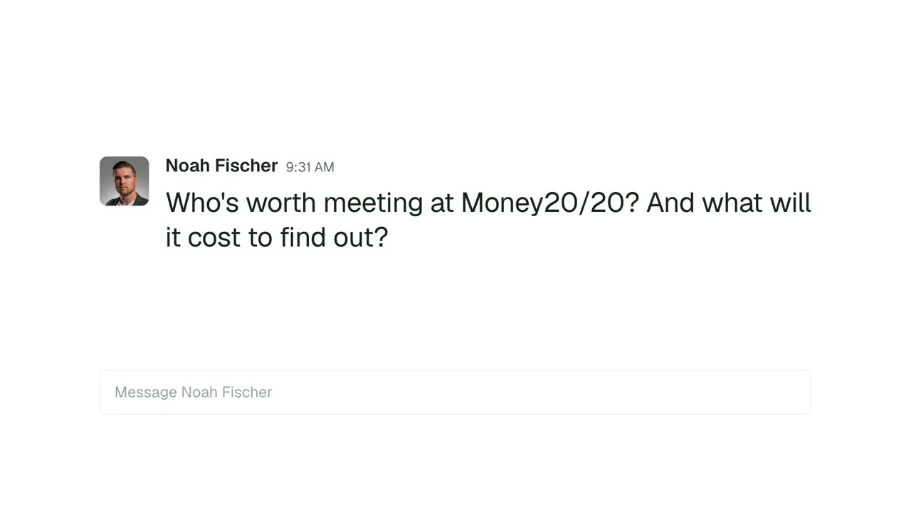
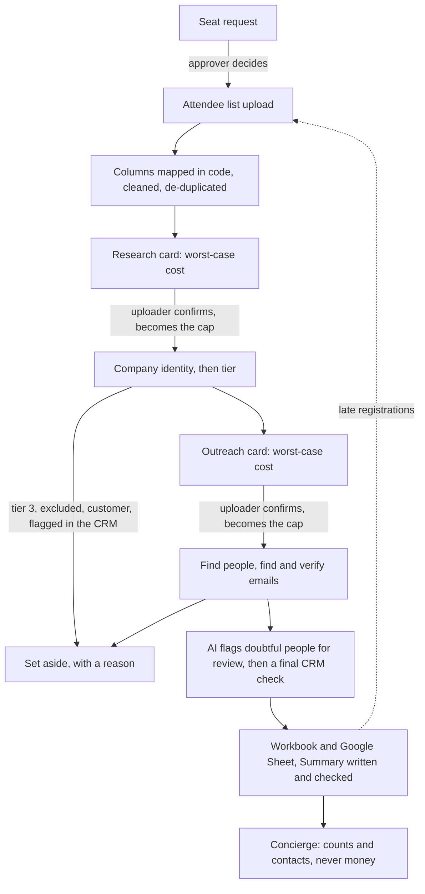

# Events Desk

[](https://github.com/bryanacevedo/events-desk/actions/workflows/ci.yml)

Events Desk is for a person who runs events all year. You go to a lot of conferences. For each one you need three things: who asked for a seat and who said yes, who is worth meeting in the attendee list, and how to reach them without paying for the same data twice.

You ask for a seat. Someone approves it. You upload the attendee list. The desk works out which companies and people matter, finds and checks their emails, and hands back a Google Sheet (or an Excel file) your sales team can work from. If more people register later, you upload the new file and the desk adds only the new ones.

**[Try the live demo](https://events-desk.onrender.com).** Everything in it is invented and every vendor is simulated. If it has been idle, the first load takes about a minute.

It is a portfolio project. Read "What is proven and what is not" below before you trust any number in it.

[](https://bryanacevedo.github.io/events-desk-site/video/events-desk.mp4)

The walkthrough covers the whole system, following one list from the demo: invented people, simulated vendors.

## What it does for you

- **Seats.** Each person asks for their own seat from a catalog of events. Approvers decide. Nobody approves their own request. A budget warning never blocks a decision.
- **One attendee list per event.** Upload a CSV or Excel file. Columns are mapped in code, rows are cleaned and de-duplicated, and anything doubtful is set aside with a reason. The original file is kept until a person replaces the list or deletes the event.
- **A cost card before any spend.** The desk shows the worst case first: credits per data provider, and AI calls with an estimate in dollars. The person who uploaded the list confirms it, and that confirmation becomes the cap. The AI cap counts calls, so its dollar figure is an estimate and not a limit.
- **A tiered list.** Companies get a tier from 1 to 3 against your ideal customer profile (ICP). Titles get a tier. Together they give each person a priority of A, B or C. When the desk cannot tell, it opens a case and asks a person.
- **Emails you can use.** Only addresses that pass the checks stay on the list. Everyone dropped has one reason, and you can read it.
- **A Sheet that reads like a briefing.** The Summary tab opens with a short written view of the event: why you went, how the list compares with your ICP and with other lists, and where the accounts stand in the CRM. Reps then work in the Attendees, Prospects and Companies tabs, and a reviewer clears flagged people on the Review tab.
- **Late registrations.** Add a new file to a delivered event. The desk finds who is new, researches only them, and merges them in. Review decisions and notes that people typed into the Sheet are kept, except an edit made during the rebuild itself.
- **A year view.** Overview, an Events timeline, a Budget page (tickets only), a Usage page (credits per provider, AI in dollars, and what reuse saved) and global Settings, which only the GTM team can change.
- **Concierge.** A Q&A agent over the delivered lists, in Slack or from the command line. It reads counts and contacts. It cannot reach money.

## How it works



TypeScript throughout. Node runs the TypeScript directly. The server is Hono and the web app is React with Vite. The database is Postgres (PGlite, an in-process Postgres, in the demo). CHECK constraints in the database enforce a few rules: a drop always has a reason, a declined approval always has a reason, ledger amounts are never negative. Jobs live in a Postgres table and are claimed with `FOR UPDATE SKIP LOCKED`, so there is no queue to run. Slack is the live approval surface. Concierge is an MCP server.

Where AI runs: reading the ICP document, company tiering, reading a company website when the facts are thin, the job titles a rules table cannot place, review flags, the Summary's opening, and Concierge. AI writes no text into the people rows. Two pieces of model-written text reach the workbook: the Summary's opening, which code checks, and the short note on the Companies tab when the model read a company's website. A tier's cited fact can repeat that note. Tier and review answers are codes from a fixed list, and the fact a tier cites must be copied from the facts the desk supplied, then checked.

The full behavior is in [docs/SPEC.md](docs/SPEC.md). The reasons behind the design are in [docs/DECISIONS.md](docs/DECISIONS.md). Reuse, CRM checks and the person record are in [docs/DATA-HYGIENE.md](docs/DATA-HYGIENE.md), and late registrations are in [docs/NEW-REGISTRATIONS.md](docs/NEW-REGISTRATIONS.md).

## What makes it careful

**It is built not to pay for the same data twice, and it shows what that saved.** Company facts are kept for 90 days. A company's tier is kept by domain and ICP version. Title readings, paid person lookups, Apollo email-waterfall results and LinkedIn lookups are kept, and email check results are reused for 30 days, good or bad. A person lookup older than 180 days is bought again. If a stored record older than 30 days shows the person changed jobs, it is bought once, fresh. Each time a stored answer replaces a call that would have been paid, the desk writes it down at the cost it avoided. Usage shows that as "saved" on each provider's own pool, and for AI as dollars. A stored answer counts as saved only when another event, or this event before its first card was approved, wrote it.

**Apollo for finding, ZeroBounce for checking, and two checks.** These are the only two email vendors the code calls. Apollo's match runs first. On a miss, Apollo's email waterfall runs by polling, and the sources inside it are chosen in Apollo's own settings. An address Apollo finds stays only if Apollo marks it Verified and ZeroBounce passes it. For a waterfall address, both answers arrive in the one Apollo response, so the desk is reading Apollo's report of the ZeroBounce pass, and the shape of that response is unconfirmed. An address that came with the attendee list is checked by ZeroBounce, and it shows as "Verified once" unless an answer we already hold says Apollo verified it too. The desk does not spend a credit to find out. Anything uncertain (catch-all, unknown, a verifier error) drops the person with a reason. Nothing uncertain stays on the list.

**Salesforce unsubscribe and do-not-contact checks, on a simulated CRM.** Email Opt Out drops a person as `crm_unsubscribed`. A custom Do Not Contact flag drops them as `crm_do_not_contact`. A do-not-prospect flag excludes the company. Do Not Call keeps the person and puts a "No calls" mark on the Sheet. If any matching record is flagged, the person is flagged, and there is no override. The checks run before the first paid step, when an address is newly found, and before delivery. If a connected CRM cannot answer, the run pauses and nobody is dropped for it. This is built and tested against a simulated CRM only. See the next section for what that means in live mode.

**Human gates before spend.** A seat is approved by an approver, never by the requester. Each cost card is confirmed by the person who uploaded the list. In live mode that person must click in Slack, and the click must come from the Slack user mapped to their name. Every paid vendor and model call inside a run reserves against the confirmed card under a database row lock before it runs. A paid call whose outcome is unknown is never repeated. One known exception: an outage in the middle of tiering a company can repeat that company's completed model calls on resume, inside the same cap. A step no approved card names is refused. Two things sit outside the cards: reading an ICP document and its test bench call the model with no card and do not appear in Usage, and Apollo's company and people searches are treated as free, which is unconfirmed, so they are not on the ledger.

**Credits and AI dollars are never mixed.** Each data provider has its own pool of credits and no dollar value. Only AI is in dollars. The two are never added or converted. Where a model call has token counts, the dollars are priced from those tokens. A call without them (every simulated call) is counted at a flat rate and shown apart.

**New registrations are added without re-paying.** A new file on a delivered event becomes a hidden event of its own. Rows already on the list are found by email, LinkedIn or name and set aside. Companies the delivered list already knows come across with their tier and domain, so the new people there cost nothing for the company. It has its own cost card and cap, so it cannot draw on the first one. When it finishes, it merges into the delivered event in one transaction. Delivered people and companies are left as they were, with two narrow exceptions: a company the first run never tiered can get its first assessment, and new spellings of a company's name are added to it.

**A model-written Summary whose numbers are checked by code.** One model call per delivered list (a second if the first fails) writes three short parts from a packet of facts that code built: no attendee names, no emails, no CRM owner names. Code then checks each part. Every number must be in the packet or be a simple sum, difference or 100 minus a percentage of numbers in it. Every quotation must be word for word from a seat request. Every capitalized name must be in the packet. Advice, second person and markup are rejected. A part that fails is replaced by text that code writes from the same facts. The list is marked delivered before the call and a failed call cannot undo that, though the Sheet is published after it.

Also: every drop has a reason and the database refuses one without it, and Concierge reads only database views with no cost, credit, budget or seat-price column.

## What is proven and what is not

**Only simulated vendors have run end to end.** The whole flow runs in the demo and in the tests with simulated Apollo, ZeroBounce, CRM and model, from a made-up world of about 1,650 attendees. Nothing here has been run against these, and all of them are unproven:

- **Salesforce.** No Salesforce adapter exists. In live mode the desk uses a CRM that says it is not connected, so none of the Salesforce checks above run, owner and deal columns stay blank, and nothing is written back. The local opt-out list still works in every mode.
- **Slack.** Signed commands, buttons and messages are tested against fakes only.
- **Apollo.** The adapters were written from documentation and tested on faked responses. The Apollo key on file is on the free plan, which refuses its search and match endpoints, so no real Apollo call has completed and the waterfall has never been reached.
- **ZeroBounce.** The same: faked responses only.
- **Real Postgres.** Every test runs on PGlite, one connection. The network driver (postgres.js) has never run here, and the row lock has not been tested under real contention.

Also not proven: whether Apollo bills its search endpoints, the real delivery path of a delivered event to Google (only the sample workbook has been published for real), the real website reader, and a real model reading an ICP document. In the demo, the ICP is read by a deterministic parser written for the demo document.

**There is no real login, and the personal-data GET routes are open.** "Acting as" is a switch in every mode, including live. Anyone who can open the app can act as anyone, including the GTM team and the approvers. `WRITE_KEY`, if set, is one shared key for changes, does not identify anyone, and is not sent by the web app, so setting it leaves the screens read-only. Every GET route is open, with no key and no login: people, companies, cases, event activity, seat requests, the workbook, the original attendee files and rows, the opt-out list, and Settings (only changes to Settings are refused). The server listens on this machine only unless `HOST` says otherwise. Do not expose a real deployment publicly: run it behind your own access control. The hosted demo is safe to leave open because it holds only invented data, uses no keys, takes no uploads and resets when it restarts.

**The accuracy numbers from the simulated world are authored.** The generator and the simulated vendors make mistakes at rates chosen by the author. A test that reports how often tiering was right on that world is checking that the code handles those chosen mistakes. It says nothing about real vendors or a real model. One test floor was moved from 20% to 25% because the simulated second-look model had an invented catch rate (decision 27).

**Real model evals exist.** They are recordings of Opus 5.5 calls, replayed in the tests. `node scripts/eval-report.ts` prints the company-tier report. The title figures come from `src/evals/title-tier.ts` and its tests.

Company tiering, on the frozen holdout of 68 (a 95% Wilson interval in brackets). "Right" means it matched the label, and Unknown counts as wrong:

| | Right | Unknown |
|---|---|---|
| Baseline (size band plus keywords) | 54 of 68, 79.4% (68.4 to 87.3) | not applicable |
| ICP rules in code, no model | 61 of 68, 89.7% (80.2 to 94.9) | 2 |
| Hard rules, then the model | 63 of 68, 92.6% (83.9 to 96.8) | 5 |

The last row is the whole system: 8 of the 68 were decided by a hard rule in code with no model call, so it is not a model-only figure. It called no tier 3 company tier 1; the baseline did that 3 times. All 5 of its misses are Unknown, and 4 of those are cases with a deciding fact missing, where Unknown is a defensible answer that still scores as wrong. Its lead over the baseline is real in the point estimate and not shown by the intervals, which overlap. On the 38 real companies the system scored 38 of 38, the ICP rules in code alone 38 of 38, and the baseline 36 of 38, so that subset barely separates them. On the 30 fictional hard cases the system scored 25 of 30 and the baseline 18 of 30. On the development set of 120 it scored 118 of 120, but the prompts were tuned on that set.

Job titles, on the frozen holdout of 114: the keyword baseline gets 23 right (20.2%, because the titles it cannot decide count as wrong), the rules in code alone 107 (93.9%), the model alone 110 (96.5%), and rules then model 113 (99.1%, 95.2 to 99.8). None was wrongly promoted to tier 1. Function is right on 109 of 114 (95.6%).

Review flagging got recall and precision of 100% on a synthetic list of 150 people. Concierge refused 10 of 10 money questions without giving a number and picked the right tool on 10 of 10 count questions. Those two lists are written by the author.

Two cautions on these numbers:

- **The title holdout was looked at.** A first real recording failed one holdout item, a made-up title "Chief Vibes Officer" given tier 1. I fixed the rule in general terms and did not add the title to any list, but the holdout is no longer clean. Read the title figures as development figures until a fresh holdout is written (decision 25).
- **The company labels are mine.** The 38 real companies were labeled from my own knowledge, and their facts were typed by hand, so they are approximate and unverified. The 30 fictional cases were written against the same ICP rules the desk uses, so agreement there is partly circular.

The company-tier report also shows the second look, a second model that checked every tier 1. It read 22 holdout companies and disagreed on none, so I cut it from production (decision 24).

The Summary check has seen three real model calls. Eight of the nine parts passed the checks first time, and the ninth was a false rejection that is fixed. Three calls is too few to call a rate.

**Tests.** `npx vitest run` passes 827 tests with 8 skipped, across 54 files (835 in all), and `npx tsc --noEmit` is clean. Seven of the skipped tests need a real Postgres and run in CI, which starts one; the whole suite has also passed on real Postgres. The other skipped test is the `NOT MEASURED` check in `tests/company-tier-evals.test.ts`, which runs only when that recording is stale. Continuous integration runs the type check, the tests with evals held strict, the build and a boot smoke test on every push.

## Run the demo

Needs Node 22.18 or later.

```bash
make demo
```

Open http://localhost:8787, or set `PORT` if that port is taken. The demo needs no keys and ignores any you have exported. Use "Acting as" (in the sidebar on desktop, at the top on a phone) to act as a different fictional person: the requester, the approver or the GTM team.

`make ask Q="How many priority A contacts are there?"` asks Concierge about a throwaway copy of the older sample data, with a scripted model, so it can only answer that kind of question.

## Run the tests

```bash
make test          # unit and end-to-end tests, then the type check
make audit         # measures layout in a real browser at five widths; the app must be running
```

`make audit` needs Chrome (set `CHROME` if it is not in the default macOS path) and the app already serving. It checks `http://localhost:$PORT`, or 8787 if `PORT` is unset. Tests need no network and no keys.

## About the sample data

The event names in the demo are real conferences, taken from `samples/real-events.json` with the source of each date and price (null where no list price was found). Their logos are fetched from Google's favicon service at view time and are not stored here. Everything else is invented: the attendees, their companies, the staff and the seller, Orrery. Attendee lists are simulated and never describe a real event's actual attendees. Orrery is the fictional company the demo's sales team works for, and the demo ICP is Orrery's. The large demo list comes from a generator (`node scripts/gen-world.ts`) and its own fictional name, Meridian Trade Expo, appears in tests, the sample workbook and the non-demo seed. Staff headshots come from Unsplash and are credited in [CREDITS.md](CREDITS.md).

## Run it for real

The license is noncommercial. Running this inside a business needs a separate license, see [NOTICE](NOTICE). The live path is unproven (see above), so try it on a very small list first.

1. Edit `config/defaults.json`: exclusion and customer lists, title keywords, provider rates and pools.
2. Copy `.env.example` to `.env` and fill it in. With `LIVE_SPEND=1` the server refuses to start if a required value is missing. Without it, `npm start` with `DATABASE_URL` serves the app but runs no pipeline (a real database never gets mock vendors). Without a `DATABASE_URL` it uses a local database with mocked vendors, but with no demo buttons and no Slack, nothing can confirm a card, so use `make demo` to look around.
3. Create a Slack app with the `chat:write` and `commands` scopes, the command `/ask-desk` pointing at `/slack/commands`, and interactivity pointing at `/slack/interactions`. Slack must be able to reach those URLs. Seat requests are made in the web app, not in Slack. Cards are posted to the channel in `SLACK_APPROVALS_CHANNEL`, and a cost card @mentions the uploader. Set `SLACK_USER_MAP` (JSON, person name to Slack user ID, such as `{"Maya Ortiz": "U01ABC"}`): a cost card can be confirmed only by the Slack user mapped to whoever uploaded the list, and the same map stops a mapped requester approving their own seat. `/ask-desk` answers only mapped users and approvers. If Slack refuses a card, the event's activity says so and the event page can send it again.
4. Google Sheet delivery needs one complete sign-in. With a personal Gmail account, set `GOOGLE_OAUTH_CLIENT_ID`, `GOOGLE_OAUTH_CLIENT_SECRET` and `GOOGLE_OAUTH_REFRESH_TOKEN` (the last comes from `make google-auth OUT=<new file>`), and optionally `GOOGLE_SHARE_EMAILS` for editors. With none, each Sheet stays private to you. With Workspace, use a service account, a Shared Drive folder and `GOOGLE_SHARE_DOMAIN`. Never "anyone with the link". Step-by-step instructions are in [docs/GOOGLE-SETUP.md](docs/GOOGLE-SETUP.md). If the Google app is left in testing mode, its refresh token expires after 7 days.
5. Publish an ICP in Settings first. Without a published ICP, events fall back to the older single-prompt tiering.
6. Run `npm ci`, `npm run build` and `npm run migrate`, then `LIVE_SPEND=1 npm start`. Slack must reach the server through a tunnel or proxy; set `HOST` only if you have put your own access control in front of it.

**Spend guards.** A live run refuses to start on an event with more than `REAL_RUN_MAX_ROWS` source rows (default 4) before any paid call, pauses the event, and says why in its activity. `make evals-live` needs `LIVE_SPEND=1` and makes at most `EVALS_MAX_ITEMS` real model calls (default 8). `make apollo-check COMPANY="..."` tests an Apollo key and spends `MATCHES` credits (default 1), held to the row guard. Raise any of these only on purpose. The vendor charges the desk records are the configured rates, except the waterfall, which records what Apollo reports it used. None are read from bills.

## License

[PolyForm Noncommercial 1.0.0](LICENSE.md). See [NOTICE](NOTICE) and [CREDITS.md](CREDITS.md).
